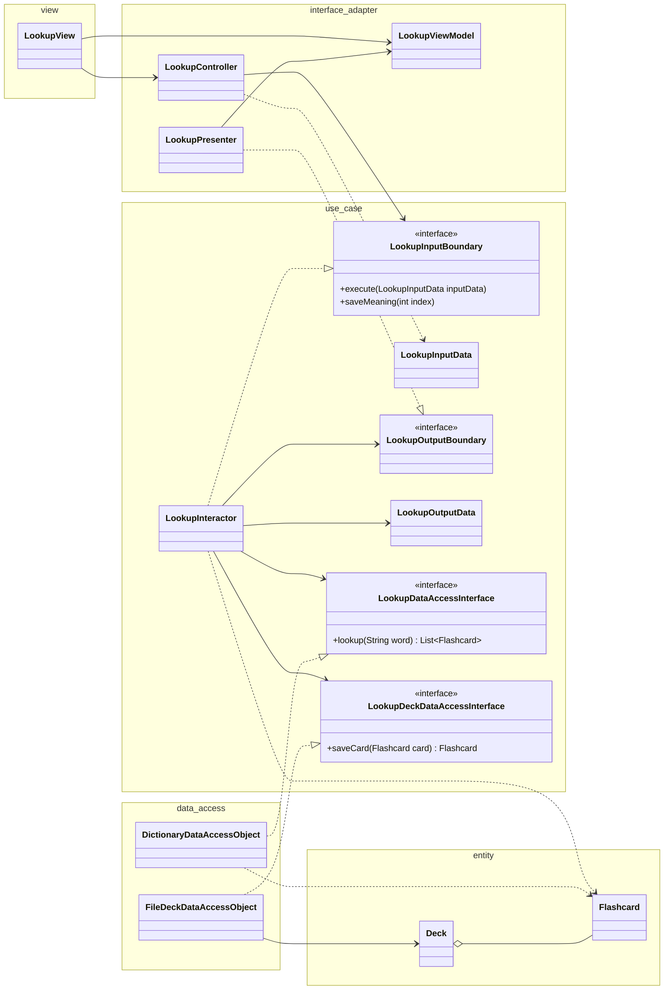
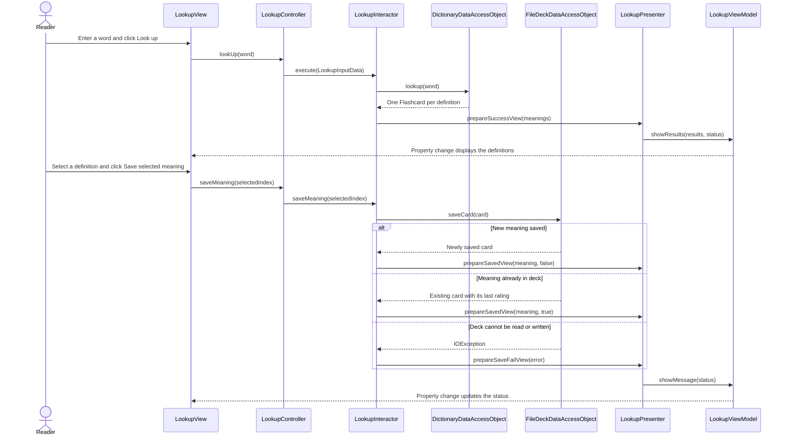

# Look up and save a word

`LookupInteractor` asks the dictionary for meanings and the deck to save the one the reader selects. Each operation has its own data access interface. `app.Main` gives the lookup and review interactors the same `FileDeckDataAccessObject`, so a saved meaning is available the next time a review starts.

## Class diagram

## Looking up a word and saving one meaning

The selected row identifies one word, part of speech and definition. A new meaning is written to `deck.json` before it is added to the in-memory deck. If saving fails, the selected row stays in place so the reader can try again.
