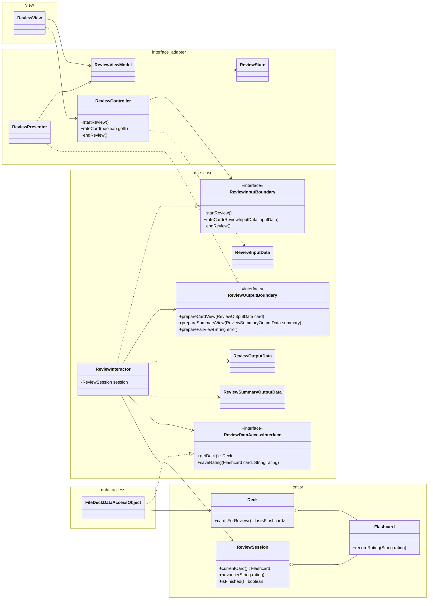
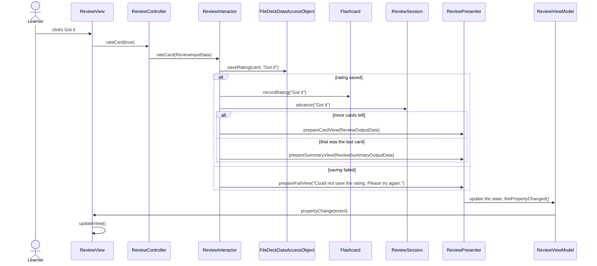

# Review saved words: design

Each box in the class diagram is one of our packages, and the packages match the Clean Architecture layers. `entity` is the innermost layer, then `use_case`, then `interface_adapter`, with `view` and `data_access` on the outside. No arrow goes from an inner layer to an outer one. `ReviewInteractor` only uses the entities and the interfaces in `use_case`, so it doesn't depend on Swing or on how the deck is stored. `app.Main` creates the objects and connects them, so it isn't shown.

## Class diagram

## Rating a card

This is what happens when the learner clicks *Got it*. *Again* is the same with the other rating.

The rating is saved before it is recorded on the card or counted. If the save fails, the learner stays on the same card and the totals don't change, which is extension 3a of the use case.
